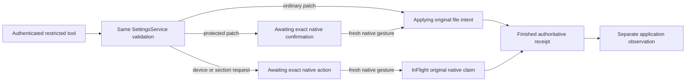

# Restricted Settings assistant architecture

Ask Settings is the optional native inspector beside conventional macOS controls. It reaches the implemented restricted Host profile through the same app-owned SettingsStore, private Session and owner client. It is not an ordinary conversation with a different prompt, another provider runtime or a generated form system. See [Settings architecture](settings.md), [kernel details](restricted-settings.md) and [native composition](../contracts/apple-settings-assistant-composition.md).

## Execution and data boundary

[`host/settings/agent.rs`](../../src/host/settings/agent.rs) owns bounded Open/Send/Poll/Close and original-Open recovery. Its supervisor is retained in the existing Host JoinSet. [`agent/settings.rs`](../../src/agent/settings.rs) selects the bounded private state view while reusing the actual `Agent::run_tools` loop and Broker. [`agent_tools.rs`](../../src/host/settings/agent_tools.rs) installs exactly seven adapters after the General selector catalog is captured. Private profile checks constrain offered and direct-ID execution; a prompt cannot enlarge them.

| Logical tool | Actual contract |
| --- | --- |
| `settings.list` | Validated descriptors; no backend load or provider discovery |
| `settings.get` | Authorized redacted Host snapshot with genuine revision/observation |
| `settings.update` | Exact revision-checked typed batch; protected changes await native confirmation |
| `settings.request_action` | Known OpenSection only; no URL, shell, credential or OS authority |
| `devices.list` | Bounded redacted public device page |
| `devices.pair` | Opaque native-action request; no model-visible invitation or trust approval |
| `devices.revoke` | Exact device/full-key request; fresh native confirmation still required |

Provider-safe encodings are the one-to-one names in [the seven-tool contract](../contracts/settings.md#exactly-seven-logical-tools), not another namespace. There is no shell/filesystem/MCP/discovery/selector/scheduler/subagent/wiki/history/owner-IPC pass-through. Current adapters derive the actual Host scope from authenticated child state; they do not forward arbitrary device preference scopes.

Explicit Open captures one configured native provider and discloses its actual model, recipient and tools without inference. Each Send requires fresh native review/consent and synchronous original admission. Missing/changed provider credentials or binding reports unavailable; there is no fallback or automatic paid retry. One genuine same-ServiceCore Get and Describe become that original turn's point-in-time context: redacted values plus safe descriptor metadata, both as untrusted data. Later controls changes affect a future original, not a rebased active turn. Canonical source checks and pre-stream accounting use the existing Host mutation guard; they do not promise atomicity with external vault changes or network cancellation.

Raw questions, answers, continuation and tool data stay in bounded fileless private SQLite/RAM. Ordinary storage retains typed namespace reservations and coarse execution fences, not a resumable transcript. There is no ordinary conversation/inbox/relay/wiki/consolidation/embedding intake. Lost RAM cannot resume a chat. InFlight/Unknown fences may quarantine the same Broker until genuine owner cleanup predicates and an explicit immutable uncertainty acknowledgement are satisfied; counters or an empty worker map are not absence-of-effect proof.

## Service actions and UI ownership

The file/application arrow applies to actual file effects; a native Completed action creates no settings revision. Original unresolved file Unknown may acquire its exact Applied/NotApplied resolution; it cannot gain another write or become a new request. Only real receipts support Saved/Completed claims.

The controller renders literal text and accepts cards only from sealed original child/turn membership, scoped Inspect and live exact-reference Details. Its whitelist is Patch, Device Pair/Revoke and Native OpenSection. It cannot fabricate credential, notification or final-pair-approval handles. Native Models/Tool Selection/Notifications controls require their own gestures after real known-section navigation. Device handoff reuses the actual private ceremony, full fingerprint/access review and separate approval; Pair reserves one extra approval identity before presentation. Destination selection is not success: Root's closed navigator waits for actual matching appearance; unsupported Owner Security is dismissed.

One current-or-closing child per exact native Owner, eight retained contexts, one coalesced Poll and one pending refresh keep UI work bounded. The shared Store still enforces64 combined identities, four effects and eight Owners; each original Send reserves nine identities including worst-eight mutations. Private UI text cells total at most147456 bytes before Swift/platform/Session copies; this is not an RSS or erasure guarantee. Details are in [consumer](../contracts/apple-settings-assistant-ui.md), [Session](../contracts/apple-native-settings-assistant-session.md) and [bridge](../contracts/apple-settings-assistant-ui-bridges.md) contracts.

Covering the pane clears private text/review and pauses publication/reads. Its own authenticated Device sheet keeps the original child live through approval; actual collapse/hide/background/connection/Owner retirement instead closes it. Synchronous Store retirement hooks prevent old callbacks publishing into a new Owner on the same connection. Original callback/CloseOpen joins precede parent/client shutdown, without stopping the independent Host. Unknown never becomes Closed from a timeout, missing receipt or clean generic report.

## Exact evidence and limitations

The final macOS consumer/navigation composition in PR [#163](https://github.com/izyuumi/everything/pull/163), head `81810ec3be51ba5bbfb05b83fab9414cf87b1778`, passed [Ubuntu validation](https://github.com/izyuumi/everything/actions/runs/38943440168) and [both SDK builds/analyses plus detector/compatibility](https://github.com/izyuumi/everything/actions/runs/38943440172). Four checkout-bearing jobs report synthetic merge `d4936e88b9d51f0b8683ad26bf598546a03bba25`, tree `00a2f88b42ade70ccb6bf12068d9fe58e5cbd72e`, equal to the published source. The prior failed private Observable-macro build remains separate. This is five actual jobs, not MSRV/release/runtime evidence.

The earlier runtime's exact static/release evidence and disposable preparations retain their own [validation scope](../development/restricted-settings.md). No successful provider stream, native Apple interaction, end-to-end settings walkthrough or security review is established here. Remote private Settings/grants and iOS assistant composition remain separate #116/#117 work. Issues #115/#118 remain open for actual manual acceptance; deferred automated assertions remain [#32](https://github.com/izyuumi/everything/issues/32).
